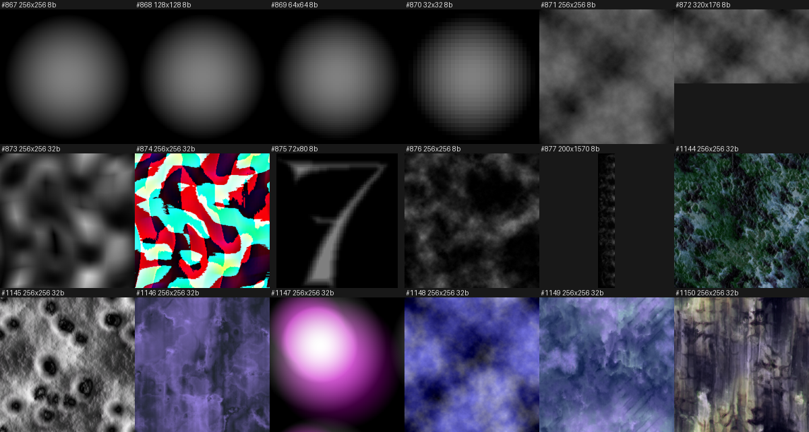
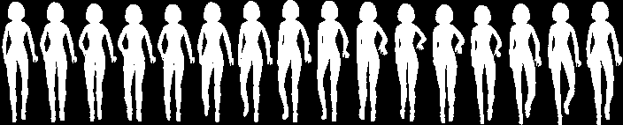

# Heaven Seven - how the demo is built

**Heaven Seven** by Exceed (Mekka & Symposium 2000, 64k intro; the Win32 `HEAVEN7W.EXE` is 65,536 bytes after UPX, 112 KB unpacked). Pure software renderer: DirectDraw only to blit one surface, DirectSound for the music (it also provides the clock when sound is on). 168 s, 4181 frames on a 25 fps grid in this port.

## Phases
1. **"please wait"**: every texture is generated procedurally (about 1.5 G x86 instructions in the emulator). 67 % of the first 200 M instructions are in the crack-growth routine 0x409c7c.
2. **Playback**: the music thread fills a 4 s looping DirectSound buffer; the main loop converts the clock to demo time and evaluates the scene graph.

## An operator-graph engine, not hard-coded effects
A bytecode stream builds operator instances (0xa8 bytes each: kind, inputs, three handlers, time accumulator, animation channels). Textures and effects are the same graph, evaluated once (textures) or per frame (scene). Node classes include text (bitmap font with MMX blur and a bilinear glyph blitter), sprites (nearest / rotated / unscaled blitters), glow streaks, a spline animation system (TCB-like tangents, one channel evaluator for everything), and a 3D pass.

## The 3D pass
A subdivision ray caster: per-line records, object ray/plane/sphere tests through a vtable, MMX span shaders (0x4036af / 0x404234). About 1,850 distinct instructions.

## What the port does
`h7core` does not re-implement the effects by hand for the final result: it **statically recompiles the original x86** (17,063 instructions, 2,391 basic blocks, `re/mk_full.py` + `re/recomp.py` -> `orig_gen.rs`), runs it on a small x86/x87/MMX runtime, and fakes only the Win32/DirectDraw/DirectSound calls. Hand ports (texture ops, blitters, scene evaluator, 3D set-up) were written first, each verified against the emulator with differential vectors (thousands in total), and remain as readable models.
- **Frames:** all 4181 frames bit-exact from a cold start. The scene is not a pure function of time (rotating objects accumulate float rounding every frame), so frames are only exact on the 40 ms grid stepped from the start; seeking replays from a checkpoint.
- **Music:** an MXM tracker module synthesised at 44.1 kHz stereo (32 channels, MMX 16.16 linear resampling with volume ramps). 15,435,000 samples = 175 s, 0 differing samples vs the emulator, defined as an ideal 5 ms mixer thread (the fill schedule changes note onsets by a few ms).
- **Display:** 320x240 with the picture letterboxed at 320x176 at the top (see `--crop` in `h7gen`), shown at 4:3. An optional WebGL CRT pass (display only) adds curvature, scanlines, shadow mask and bloom.

## 2D/3D art used

There are no art files: `HEAVEN7W.EXE` (65,536 bytes) contains a ~7 KB build script, a 5,005-byte font stream and the generator code, and every texture, bitmap and sprite below is produced at start-up ("please wait"). The 3D pass draws analytic primitives by ray casting (see the end of this section).

How the surfaces below were obtained: the Rust core (`h7core::cold::build_until_eval(2)`, the static recompile of the original's own start-up, no snapshot file) was run to the entry of the first frame's evaluator call; the 12.6 MB heap was dumped and the object table read at `0x20001000 + 0x1e0 + idx x 0x200` (`+0x18` w, `+0x1c` h, `+0x20` pitch x 4, `+0x24` 32-bit data, `+0x28` 8-bit data, as in `re/NOTES.md`). 110 table entries hold a surface (109 distinct); the previews were rendered with Pillow (`python3 -I`). The dump helper lived outside the repository. Colour counts are distinct pixel values.

### Textures and bitmaps

| Object idx | Size | Depth | Values | Notes |
|---|---|---|---|---|
| 867, 868, 869, 870 | 256x256, 128x128, 64x64, 32x32 | 8 bit | 128, 128, 128, 120 | a soft disc and its three 2x2-box-filter mip levels (op 23 is the downsample; the notes list it three times in the script) |
| 871, 876 | 256x256 | 8 bit | 116, 122 | cloud-like grey textures |
| 872 | 320x176 | 8 bit | 115 | surface of the picture size (the frame is 320x176, letterboxed at the top of 320x240) |
| 873 | 256x256 | 32 bit | 206 | grey blobs |
| 874 | 256x256 | 32 bit | 22145 | warped red/cyan/yellow pattern (shown as the dword's bytes 2,1,0 = R,G,B; the channel meaning of this intermediate plane is not established) |
| 875 | 72x80 | 8 bit | 60 | a "7" (crack growth, op 24, then the 3x3 blur, per the notes) |
| 877 | 200x1570 | 8 bit | 107 | narrow strip (the notes: a 160x1256 bitmap resized to 200x1570 by a blitter) |
| 1144..1150 | 256x256 | 32 bit | 31401, 1002, 502, 10494, 8782, 10552, 28090 | seven colour textures (green rock, grey pitted, violet, pink glow, blue clouds, blue-violet, brown/yellow streaks) |

Generators (all in `re/NOTES.md`, each ported and verified bit-exact against the original): image-program codes 0x10 constant fill, 0x11 diamond-square plasma, 0x12 value noise, 0x13 sine plasma, 0x14 random dark blobs, 0x15 radial sine ring; filter codes 0x20 shifted copy, 0x21 sine warp, 0x24 displacement map, 0x31..0x33 overlays/contrast, 0x35 auto-levels + gradient map, 0x36 emboss, 0x37 HSV shift, 0x40 3x3 blur, 0x41 vertical streak, 0x50/0x51 mixes; blend modes add, subtract, difference, multiply, screen, overlay. Script ops: 7 (256x256 32-bit from the image program), 20 (the same to an 8-bit surface, value >> 1), 23 (2x2 downsample), 24 (crack growth, 0x409c7c, 67 % of the first 200 M instructions), 25 (emboss/edge), 26 and 30 (tiled multiply / copy), 28 (lighting blend). The mapping of each preview above to its exact op chain is not established here.

Figure: [textures and bitmaps](figures/art_textures.png)

### Sprite flip-book

Object 878: 44x142, 8 bit, pitch 64, 48 frames at a stride of 0x3000 bytes (`+0x2c` = 48, `+0x38` = 0x3000, `+0x34` = data), evaluated by class 49 (0x4081e8). Frames hold 2 or 3 distinct values (maximum 127): a white walking-figure silhouette, drawn by the rotated sprite blitter 0x40ccc5. How the frames are produced was not traced. [Every third frame](figures/art_flipbook.png):

### Font

30 glyphs (codes 32 space, 45 `-`, 46 `.`, 51 `3`, 63 `?`, 97..121 `a`..`y`) decoded from the 5,005-byte stream at `0x41903c..0x41a3c9` (`re/font_stream.bin`, loader opcode 4 = 0x408e82): per glyph a column bitmap of 48 rows (6 bytes per column), width 15 to 56, drawn as ink 0x7f and blurred with the MMX 3x3 blur (centre weight 5); two 2x2 downsampled copies (24 and 12 rows) follow for small text (object table: 3 objects per glyph). The glyphs below are the original's own output (`re/glyph_truth.json`, 30/30 bit-exact against the port), cropped to the glyph width and shown with the values doubled (maximum value 126):

### 3D objects

Per the notes the 3D pass ray-casts objects with an object vtable: plane, sphere, box-like and composite (class 32) types, 22 class-52 / class-20 objects plus the camera in the frames examined. No vertex or face lists were found in the notes for these; a midpoint-displacement subdivision helper (0x40b2a8 / 0x40b341) exists, but this document does not establish what it is used for. A 909 KB table is built at start-up (its role is not described in the notes).

## Method
Unpack with Unicorn (run the UPX stub, stop at the first fetch from the unpacked section) -> harness with fake DirectX and a virtual clock -> trace and profile -> port class by class with differential tests -> recompile what is too big to port -> compare every frame and sample. The full log, with the dead ends, is `re/NOTES.md`.
